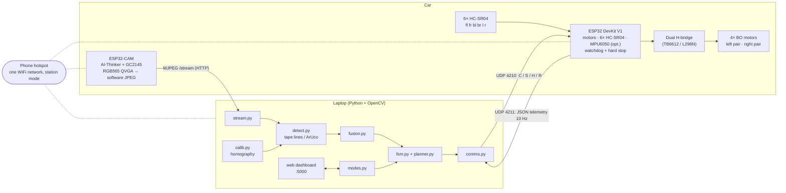

# Pinacle: a 1:10 self-parking car

Pinacle is a college-project car that finds a parallel parking bay with a camera and
parks itself. It is a skid-steer (differential drive) chassis with four BO motors.
A front camera spots the bay while the car approaches, a laptop does the vision and
planning, and an ESP32 handles the motors and safety in real time. A web dashboard
lets you drive it by hand or press **FIND & PARK**.

> Status: the software base is complete and tested in simulation. It has **not** run on
> the real car yet. See [Known TODOs](#known-todos).

## Architecture



**Parking maneuver** (scripted, using the fact that skid-steer can rotate in place):
pull alongside the bay → stop at an offset → rotate 90° → reverse in (rear sensors
watching) → rotate back → centre between the front and rear obstacles.

**State machine:** `IDLE → SEARCH → ALIGN → MEASURE → MANEUVER → ADJUST → PARKED`,
with `ABORT` reachable from any state. After `PARKED` or `ABORT` the car is back in MANUAL.

### Repository layout

```
firmware/cam/cam_stream/        ESP32-CAM MJPEG streamer
firmware/devkit/drive_ctrl/     DevKit: drive_ctrl.ino, pins.h, motors, sonar, gyro, comms
laptop/pinacle/                 stream, calib, detect, fusion, planner, fsm, comms, modes, config
laptop/pinacle/web/             Flask server + static HTML/JS dashboard (no build step)
laptop/main.py                  entry point (--sim, --record)
laptop/tools/                   record_frames.py, calib_capture.py
laptop/sim/                     fake_car.py (UDP DevKit simulator), synth.py (synthetic video)
laptop/tests/                   pytest suite (no hardware needed)
docs/CONTRACT.md                protocol + module interface spec (source of truth)
config.yaml                     all laptop tunables
```

## Hardware

| Part | Qty | Notes |
|---|---|---|
| ESP32-CAM, AI-Thinker, **GC2145** sensor | 1 | Not an OV2640: there's no hardware JPEG, so frames are JPEG-encoded in software (~8–12 fps at QVGA) |
| ESP32-CAM-MB USB board (or a USB-serial adapter) | 1 | For flashing and the Serial Monitor |
| ESP32 DevKit V1, 30-pin | 1 | Motor control and safety |
| Dual H-bridge motor driver | 1 | **Model undecided.** The code supports a generic IN1/IN2 + PWM per side (TB6612FNG or L298N) |
| BO gear motors + wheels | 4 | Skid-steer: left pair and right pair each wired in parallel |
| HC-SR04 ultrasonic sensors | 6 | front-left, front-right, back-left, back-right, left, right. **Echo is 5 V: use a divider to 3.3 V** |
| MPU6050 gyro (optional) | 1 | I2C SDA 21 / SCL 22. Without it, rotations are timed |
| Buzzer (GPIO18), LED (GPIO19) | 1 each | Status: LED solid = linked, buzzer beeps during a hard stop |
| Battery pack + buck converter | 1 | Separate the motor and logic supplies where possible |
| 1:10 chassis, a phone for the hotspot, a laptop | – | |
| White tape (or 4 ArUco markers, DICT_4X4_50 IDs 0–3) | – | Marks the parking bay on the floor |

## Arduino setup

1. Install the **Arduino IDE 2.x**. In *Boards Manager*, install **esp32 by Espressif Systems, version 2.0.17**.
   - **Do not accept the "board updates available" popups.** Version 3.x changes the camera and
     PWM APIs, and these sketches will not compile on it. If you've already updated, reinstall 2.0.17.
2. Copy each `secrets.example.h` to `secrets.h` in the same folder and fill in the hotspot name and password:
   - `firmware/cam/cam_stream/secrets.h`
   - `firmware/devkit/drive_ctrl/secrets.h`

   Both are gitignored.
3. **ESP32-CAM** (`cam_stream.ino`): set *Board* to "AI Thinker ESP32-CAM", *PSRAM* to "Enabled",
   *Partition Scheme* to "Huge APP (3MB No OTA)" and *Upload speed* to 115200.
4. **DevKit** (`drive_ctrl.ino`): set *Board* to "DOIT ESP32 DEVKIT V1" (or "ESP32 Dev Module").
   Before flashing, set the real pins in `pins.h` (see [Known TODOs](#known-todos)).
   To run without the gyro, set `#define USE_MPU6050 0`.
5. Open the Serial Monitor at **115200 baud**, with the line ending set to "Newline".

**Every sketch waits for Enter before it starts.** After reset it prints
`ready - press Enter` every 3 s and does nothing else, so a crash can't turn into a reboot loop.
Press Enter in the Serial Monitor to continue.

### The Serial Monitor freeze workaround

If the Serial Monitor freezes or shows nothing after an upload (common on Windows with these boards):

1. **Unplug** the board.
2. **Open** the Serial Monitor (115200, Newline).
3. **Plug the board in.**
4. When `ready - press Enter` appears, **press Enter**.

Both sketches were compiled with arduino-cli and esp32 core 2.0.17:
- `cam_stream` uses 27% of flash.
- `drive_ctrl` uses 57% with the gyro and 56% with `USE_MPU6050 0`.

## Network setup (phone hotspot)

All three devices join **one** WiFi network, the phone's hotspot, in station mode.

1. Turn on the phone hotspot. Use **2.4 GHz** (the ESP32 can't join 5 GHz) and WPA2.
2. Put the same SSID and password in both `secrets.h` files and in `.env`
   (`cp .env.example .env`).
3. Connect the laptop to the hotspot.
4. Flash and boot both ESP32s. Each one prints its IP to Serial after you press Enter:
   - The cam prints `Stream URL: http://<ip>/stream`. Open it in a browser to check it.
   - The DevKit prints its IP.
5. Put the IPs in `.env` (`CAM_URL`, `DEVKIT_IP`), or in `config.yaml → network`.
   Many phones keep giving a device the same IP, but check after each reboot.
6. **Windows firewall:** allow Python on *private* networks the first time it asks (or
   allow inbound **UDP 4211** and **TCP 5000**), or telemetry won't arrive.

The DevKit sends telemetry back to whichever IP last sent it a packet, so it
doesn't need to know the laptop's IP.

## Protocol

The full spec, including the safety rules, is in [`docs/CONTRACT.md`](docs/CONTRACT.md). The
firmware, `comms.py` and `fake_car.py` all implement it.

**Laptop → DevKit: UDP port 4210, one ASCII line per datagram**

| Packet | Meaning |
|---|---|
| `C,<seq>,<left>,<right>` | Motor speeds, each in -255..255 (sign = direction) |
| `S,<seq>` | Stop now (also cancels a rotation) |
| `H,<seq>` | Heartbeat (feeds the watchdog only) |
| `R,<seq>,<deg>` | Rotate in place by `deg`, **positive = counter-clockwise (left)**. Uses the gyro; with no gyro, it spins for `abs(deg) × ROTATE_MS_PER_DEG` ms |

**DevKit → laptop: UDP port 4211, JSON at 10 Hz**

```json
{"seq":123,"state":"OK","d":[42.0,40.5,-1,18.2,-1,30.1],"yaw":87.5,"busy":false}
```

- `state` is one of `OK`, `ESTOP` (hard stop active) or `WATCHDOG` (the link is silent).
- `d` is the distances in cm, in the order `[fl, fr, bl, br, l, r]`, each the median of 3 readings. `-1` means no echo.
- `yaw` is in degrees, CCW positive. It is `null` when the gyro is disabled or missing.
- `busy` is true while an `R` rotation is running.

**Safety on the DevKit:**
- **Watchdog:** the motors stop if no packet arrives for 300 ms. The laptop sends `H` at 10 Hz in every mode, so this only happens if the link or the laptop dies.
- **Hard stop:** it triggers below 8 cm on the sensors in the direction of travel:
  - forward checks `fl`/`fr`
  - reverse checks `bl`/`br`
  - rotating checks all four corners

  It releases at 10 cm. Driving away from the obstacle is always allowed.
- **Sonar timing:** the sensors fire one at a time, 30 ms apart.

## How to run

### 1. Laptop setup (once)

```bash
cd pinnacle-self-parking-car
python -m pip install -r requirements.txt     # Python 3.10+
cp .env.example .env                          # then edit it
python -m pytest                              # 129 tests, no hardware needed
```

### 2. Simulation first (no hardware)

```bash
python laptop/main.py --sim
```

Open **http://localhost:5000**. `--sim` does three things:
- It starts `fake_car.py` on localhost, a UDP DevKit simulator with a small 2D world, the watchdog and the hard stop.
- It plays a synthetic camera video of a taped bay.
- It loads a matching sim calibration.

FIND & PARK is enabled straight away, and a full park runs end to end. Your
`config.yaml` is never modified in sim; the sim writes `laptop/sim/sim_config.yaml` instead.

Other options:
- `--no-gyro` makes the simulator send `yaw: null` and do timed rotations.
- `--record` also saves the annotated video.
- `-v` gives debug logs.
- `--port` changes the dashboard port.
- You can also run the simulator on its own: `python laptop/sim/fake_car.py -v`

### 3. The real car

1. Phone hotspot on, laptop connected, `.env` filled in.
2. Power the car **with the wheels off the ground** the first time.
3. Open the Serial Monitor for each ESP32 and press Enter. Note the IPs.
4. `python laptop/main.py` (add `--record` to save video). Open http://localhost:5000.
   From a phone on the same hotspot, use `http://<laptop-ip>:5000`.
5. Check that both link indicators are green, the video is live and the sonar values change.
6. Calibrate (see below), then drive it by hand before trying FIND & PARK.

Tools:
- `python laptop/tools/record_frames.py --out recordings/frames` saves raw frames for offline work.
- `python laptop/tools/calib_capture.py` is a standalone OpenCV-window calibration tool.

## Using the dashboard

- **Live video:** the annotated camera feed, with the detected tape lines, the bay box, the pose and the FSM state.
- **Manual drive:**
  - Buttons: forward / back / left / right / rotate-left / rotate-right.
  - **Hold to drive:** the command repeats every 100 ms while held and stops the moment you release (or your finger slides off, or the tab loses focus).
  - The speed slider sets the PWM.
  - Keyboard: **W A S D** to drive, **Q / E** to rotate, **SPACE** for e-stop.
  - The laptop also stops the car if no manual input arrives for 250 ms.
- **FIND & PARK:** runs SEARCH → ALIGN → MEASURE → MANEUVER → ADJUST → PARKED.
  - It stays **disabled, with the reason shown**, until all three conditions hold:
    1. DevKit telemetry arrived within the last 1 s.
    2. The camera stream is live.
    3. A calibration is loaded.
  - The server enforces these conditions too.
  - **The human always wins:** any manual drive input during AUTO aborts the automation and switches to MANUAL.
  - AUTO also aborts if the DevKit reports ESTOP or WATCHDOG, or if the dashboard page goes silent for 1 s.
  - After PARKED or ABORT, the mode returns to MANUAL.
- **ABORT / E-STOP:** the big red button, always enabled. It sends `S` immediately and puts the FSM in ABORT.
- **Status panel:**
  - mode, FSM state and step
  - the 6 ultrasonic distances drawn around a top-down car outline
  - yaw (or "no gyro")
  - camera and DevKit link status with their age
  - detection confidence
- **Calibration** (`/calibrate`):
  1. Put 4 marks on the floor in front of the car, spread across the camera view.
  2. Measure each mark's position in the **car frame**, in cm: the origin is the floor under the centre of the front bumper, **+x is forward and +y is left**.
  3. On the page, freeze a frame, click the 4 marks in order and type their x, y.
  4. Press save. This writes the homography to `config.yaml → calibration` and shows the reprojection error.

  Re-calibrate whenever the camera mount moves.
- **Logging:** each run writes a CSV log to `logs/` with telemetry, commands, mode changes and state changes. `--record` also saves the annotated video to `recordings/`.

## Config reference (`config.yaml`)

Units are cm, degrees and seconds unless noted. `.env` can override `CAM_URL` and `DEVKIT_IP`.

| Section | Keys | What they do |
|---|---|---|
| `network` | `cam_url`, `devkit_ip`, `cmd_port` 4210, `telem_port` 4211, `heartbeat_hz` 10, `telemetry_timeout_s` 1.0 | Addresses, ports, the heartbeat rate, the telemetry "live" window |
| `camera` | `live_timeout_s`, `reconnect_s`, `sim_video` | When the stream counts as live, reconnect backoff, the sim video path |
| `calibration` | `image_points`, `world_points_cm`, `homography`, `birdseye.{x_min_cm,x_max_cm,y_min_cm,y_max_cm,px_per_cm}` | Written by the calibration page |
| `detection` | `method` (`tape`\|`aruco`), `min_confidence`, `smooth_alpha` | Detector choice, the confidence gate, EMA weight of the newest frame (1 = no smoothing) |
| `detection.tape` | `hsv_low`, `hsv_high`, `canny_low/high`, `hough_threshold`, `hough_min_line_len`, `hough_max_line_gap`, `tape_width_cm` | Tape segmentation; tune `hsv_*` for your tape colour and lighting |
| `detection.aruco` | `dictionary`, `corner_ids` | Markers at entrance-left, entrance-right, back-right, back-left |
| `car` | `length_cm`, `width_cm`, `max_pwm`, `min_pwm` | Body size; `min_pwm` = the BO motor stall threshold |
| `bay` | `side` (`left`\|`right`), `length_cm`, `width_cm`, `length_tol_cm`, `width_tol_cm` | Which side the bay is on and its expected size |
| `fusion` | `side_clear_cm`, `min_gap_margin_cm`, `wall_max_cm` | Side-sonar "gap open" threshold; the required gap = car length + margin |
| `planner` | `drive_pwm`, `reverse_pwm`, `pull_past_cm`, `rotate_deg`, `reverse_stop_cm`, `reverse_max_cm`, `centre_tol_cm`, `centre_pwm`, `pwm_per_cm_s` | Maneuver geometry and speeds. **`pwm_per_cm_s` must be measured on the real car** |
| `fsm` | `search_pwm`, `search_timeout_s`, `align_tol_deg`, `align_tol_cm`, `measure_frames`, `step_timeout_s`, `adjust_max_iters`, `settle_s`, `sonar_latency_s`, `align_gain` | State-machine timing and gains |
| `manual` | `default_speed`, `repeat_ms` 100, `deadman_ms` 250 | Teleop behaviour |
| `safety` | `ui_heartbeat_s` | AUTO aborts if the dashboard goes silent this long |
| `web` | `host`, `port` 5000, `jpeg_quality` | Dashboard server |
| `logging` | `dir`, `record_dir` | CSV logs and recordings |

The firmware tunables (rotation speed and timing, PWM frequency, thresholds) live in
`firmware/devkit/drive_ctrl/pins.h`.

## Milestones

- [x] Software base: firmware for both boards, the laptop stack, the dashboard, the simulator, 129 tests
- [x] Full FIND & PARK run in simulation
- [ ] Wire the car; fill in `pins.h`; both boards boot and join the hotspot
- [ ] Camera stream visible on the dashboard; floor calibration saved
- [ ] All 6 sonars and the hard stop verified with the wheels off the ground
- [ ] **Dashboard teleop on the real car: by 7 Nov**
- [ ] Measure `pwm_per_cm_s`, `ROTATE_MS_PER_DEG` (or gyro rotations ±3°) and `min_pwm`
- [ ] Bay detection reliable on the real floor (tune the HSV thresholds)
- [ ] **A full FIND & PARK run on the real car: by 14 Nov**

## Known TODOs

**Placeholder pins** (`firmware/devkit/drive_ctrl/pins.h`; each is marked `// TODO: confirm wiring`).
No `devkit_hw_test.ino` existed, so none of these come from real wiring:

| Signal | Placeholder GPIO |
|---|---|
| Left motors IN1 / IN2 / PWM | 25 / 26 / 27 |
| Right motors IN1 / IN2 / PWM | 32 / 33 / 23 |
| Motor driver STBY (TB6612 only) | not assigned; tie STBY to 3V3 or free up a pin |
| Sonar fl trig / echo | 16 / 34 |
| Sonar fr trig / echo | 17 / 35 |
| Sonar bl trig / echo | 5 / 36 |
| Sonar br trig / echo | 14 / 39 |
| Sonar l trig / echo | 15 / 4 |
| Sonar r trig / echo | 2 / 13 |

Notes on those pins:
- GPIO 2, 5 and 15 are strapping pins, and GPIO 2 is also the DevKit's on-board LED. They're used only as trig outputs, which is safe, but move them if you see boot problems.
- All 18 safe GPIOs are in use, so adding anything else means freeing one.

**Undecided parts:**
- **Motor driver model (TB6612FNG vs L298N).** The code is generic. For a TB6612, set `PIN_MOTOR_STBY` (or tie STBY high). For an L298N, expect about 2 V of drop: BO motors may need a higher `min_pwm`. You may also need `LEFT_INVERT` / `RIGHT_INVERT`.
- **Buzzer type.** `BUZZER_ACTIVE 1` assumes an active buzzer. Set it to 0 for a passive one (it then uses a 2.7 kHz tone).
- **MPU6050 fitted or not.** Leave `USE_MPU6050 1`; the code falls back automatically if the MPU doesn't answer.
- **Bay marking:** tape colour (`detection.tape.hsv_*`) or ArUco markers, and the bay size (`bay.*`).
- **Bay side:** `bay.side` is `right` by default.

**Values to measure on the real car:**
- `ROTATE_MS_PER_DEG` (6.0 is a guess), `ROTATE_PWM`, `ROTATE_MIN_PWM`
- `planner.pwm_per_cm_s`, `car.min_pwm`, `car.length_cm` / `width_cm`
- `fsm.sonar_latency_s` (0.3)

**Known limitations:**
- **Sonar lag:** each sensor refreshes only every 180 ms (6 × 30 ms), and the median of 3 adds roughly 0.3–0.5 s of lag. At 30 cm/s the car travels 10–15 cm before a hard stop takes effect, so drive slowly near obstacles. The planner already stops the reverse early by `fsm.sonar_latency_s`.
- **Calibration assumes a fixed camera and a flat floor.** Bumping the mount invalidates it.
- **No wheel encoders.** Distances are estimated from PWM × time. The gyro (if fitted) only corrects heading.
- **One stream client.** The ESP32-CAM serves one `/stream` client at a time, so view the video through the dashboard, not by opening the camera URL in a second tab.
- `fusion.wall_max_cm` and `fsm.align_tol_cm` are read from the config but not used yet.
- **Small rotations with the gyro:** an `R` of 3° or less does nothing on the firmware (it's inside the ±3° band). The simulator is a little optimistic here.
- **Lenient telemetry decoder:** `comms.py` accepts telemetry with extra keys, as long as all five required keys are valid.
- **Not tested on hardware.** The firmware has been compiled but never run on a board.
